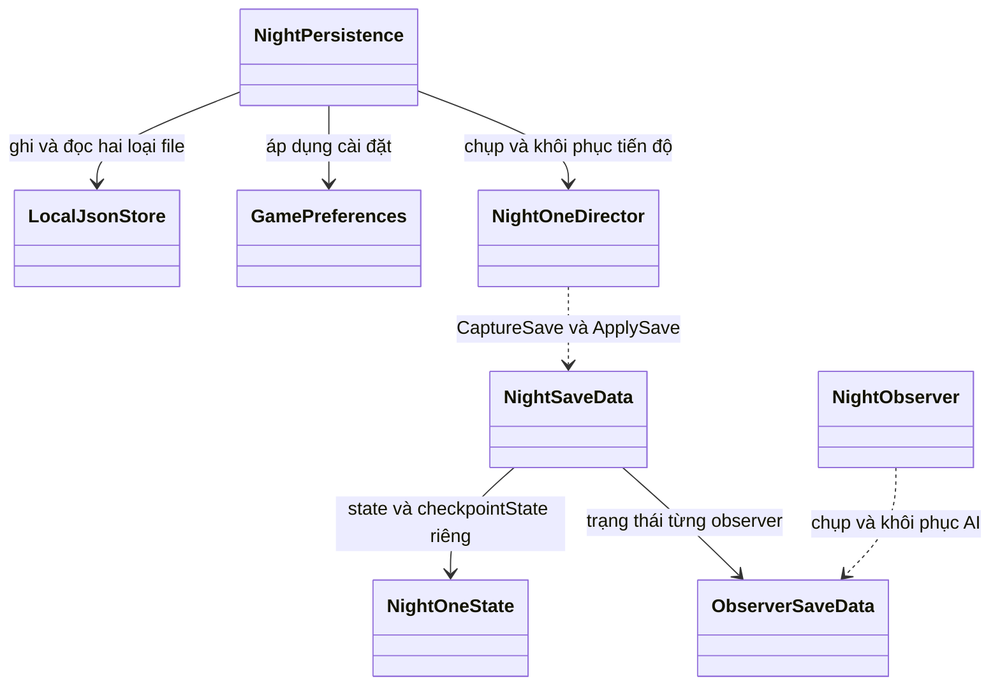

# Lưu tiến độ và cài đặt (#21)

## Phạm vi

Áp dụng cho scene `Assets/Scenes/Night01/NightOneGraybox.unity`, Unity `6000.3.26f1`. Hệ lưu dành cho bản thô Đêm 1 đang có trên `main`; các scene Đêm 2/3 cần bổ sung adapter khi triển khai #22. Không ghi dữ liệu lên server và không dùng PlayerPrefs cho tiến độ.

Khi mở scene, menu đầu game dừng thế giới và âm thanh. Chọn “Tiếp tục bản đã lưu” để khôi phục, hoặc “Chơi mới Đêm 1”. Esc trong khi chơi mở menu tạm dừng; có thể chỉnh cài đặt, tiếp tục, chơi lại, xóa tiến độ, lưu và thoát. Chơi mới/xóa bản lưu đều cần xác nhận. Xóa tiến độ giữ nguyên cài đặt và quay về menu đầu game, không tự tạo lại slot cho phiên đang bị xóa.

## Giao diện


## Dữ liệu và thời điểm lưu

- `NightSaveData`: tiến độ `NightOneState`, snapshot checkpoint riêng, vị trí/hướng/góc nhìn và tư thế nhân vật, máy điện thoại đang mở, modal, mục tiêu, đồng hồ và thời gian chờ tin nhắn, lịch observer, trạng thái truy đuổi/độ chú ý/vị trí, đèn báo động, thời lượng phiên và thông tin replay.
- Tiến độ tin nhắn, hàng đợi tin khi tắt máy, lựa chọn, sổ tay, vị trí ba lô và hình phạt bị bắt nằm trong `NightOneState` và được khôi phục cùng nhau.
- Tự ghi mỗi 2 giây theo thời gian thực; cố gắng ghi thêm khi mất focus, ứng dụng tạm dừng hoặc thoát bình thường. Hệ giữ snapshot gần nhất của frame ổn định, không lưu giữa coroutine chuyển cảnh, bị bắt hoặc tua đêm (`Busy`). Thoát giữa các đoạn chuyển này sẽ quay lại trạng thái ổn định ngay trước đó, tránh mở lại vào một coroutine đã mất.
- Đóng cưỡng bức/mất điện có thể mất tối đa khoảng tự lưu kể từ trạng thái ổn định gần nhất. Bản lưu không chạy tiếp đồng hồ trong thời gian người chơi đóng ứng dụng.

## Đường dẫn, định dạng và lỗi

Mặc định: `Application.persistentDataPath/local-v1/` (đường dẫn thực phụ thuộc company/product trong ProjectSettings và hệ điều hành).

| File | Nội dung |
|---|---|
| `night-one.json` | Một slot tiến độ Đêm 1 |
| `preferences.json` | Âm lượng, độ nhạy, mức chất lượng, tùy chọn hiện cảnh báo nội dung |
| `*.bak` | Thế hệ hợp lệ trước đó |
| `*.tmp` | File tạm trong lúc ghi |

`LocalJsonStore<T>` bọc payload bằng version và SHA-256 checksum, giới hạn đọc 4 MiB, kiểm tra schema/giá trị trước khi áp dụng. Ghi file tạm và flush xuống đĩa trước khi thay file chính; giữ bản dự phòng đã kiểm tra. Nếu file chính hỏng/ghi dở, thử bản dự phòng; không chép file chính hỏng đè lên bản dự phòng tốt. Xóa slot xóa cả file chính, `.bak` và `.tmp`.

Nếu cả hai bản không đọc được hoặc phiên bản không hỗ trợ, menu báo lỗi, giữ nguyên file và cho phép người chơi chọn chơi mới/xóa. Lỗi quyền ghi hoặc hết dung lượng được báo trên menu; nút “Lưu và thoát” không đóng game khi ghi thất bại. Khi mới mở menu, thao tác xem cài đặt không ghi đè tiến độ cũ.

Phiên bản đầu hỗ trợ envelope 1, `NightSaveData` 1 và `NightOneState` 2. Chưa có migration từ phiên bản khác. Khi thay đổi dữ liệu/scene ở các issue sau phải thêm migration hoặc cơ chế từ chối tương thích; không chỉ tăng version rồi đọc lại mù quáng. Checksum phát hiện ghi hỏng, không nhằm chống người chơi sửa file.

## Cài đặt

Âm lượng áp dụng qua `AudioListener.volume` (0–100%), độ nhạy chuột 0,02–0,30, chất lượng chọn từ `QualitySettings.names` của project. Các thiết lập được preview trong menu và ghi khi bấm “Lưu cài đặt và quay lại”. Cảnh báo nội dung mặc định bật, có thể tắt/bật lại; tùy chọn này chỉ điều khiển hiển thị cảnh báo, không sửa nội dung game. Xóa/chơi mới tiến độ không xóa preferences.

## Các lớp và tích hợp



Director gắn `NightPersistence` sau khi khởi tạo scene. Controller chờ thêm một frame để observer hoàn tất `Start` rồi mới chụp trạng thái ban đầu/mở menu. `ApplySave` kiểm tra toàn bộ schema và danh sách observer/đèn trước khi sửa thế giới. `FirstPersonPlayer` nhường UI tạm dừng cho controller nhưng giữ hành vi Esc/phone khi chơi; menu khởi động và hộp xác nhận khóa Esc để tránh vô tình ghi đè save cũ.

## Kiểm tra tự động

Chạy hai lệnh trong hai tiến trình Unity riêng, cùng một thư mục dữ liệu thử rỗng. Thay các đường dẫn bằng đường dẫn trên máy; không đặt `THREEGIO12_DATA_ROOT` trùng dữ liệu chơi thật.

```sh
THREEGIO12_DATA_ROOT=/tmp/3gio12-save-review \
  /path/to/Unity -batchmode -projectPath /path/to/repo/game \
  -executeMethod SaveProgressRegression.Write -logFile /tmp/save-write.log

THREEGIO12_DATA_ROOT=/tmp/3gio12-save-review \
  /path/to/Unity -batchmode -projectPath /path/to/repo/game \
  -executeMethod SaveProgressRegression.Read -logFile /tmp/save-read.log
```

Không thêm `-quit`: script tự kết thúc sau khi vào Play Mode và kiểm tra xong. Log thành công: `SAVE_STORAGE_CASES_PASSED`, `SAVE_WRITE_PROCESS_PASSED`, `SAVE_READ_PROCESS_PASSED`.

Script kiểm tra round-trip qua hai tiến trình, pose/crouch/camera, điện thoại/tin chờ/lựa chọn, AI/đèn, checkpoint khác state hiện tại, kết thúc và chơi lại, cài đặt, file hỏng/bản dự phòng/phiên bản lạ, lỗi ghi, giữ menu khi khởi tạo save thất bại và xóa không bị autosave tạo lại. Các smoke test Đêm 1 cũ có thể chạy với `THREEGIO12_SKIP_START_MENU=1` và thư mục dữ liệu thử riêng để tập trung kiểm tra gameplay; mặc định sản phẩm luôn có menu đầu game.

## Chạy thử bằng tay trước khi duyệt

1. Mở `NightOneGraybox`, Play, đọc cảnh báo, chọn chơi mới. Đi tới phòng 7, nhắn tin, đổi vị trí ba lô; đợi ít nhất 2 giây.
2. Esc, đổi âm lượng/độ nhạy/chất lượng/cảnh báo, lưu cài đặt. Chọn “Lưu và thoát” trong bản build (trong Editor dùng Stop).
3. Mở lại ứng dụng/Play, chọn tiếp tục. Kiểm tra vị trí, góc nhìn, tin nhắn, sổ tay, đồng hồ và cài đặt.
4. Chơi lại từ checkpoint: tiến độ quay về snapshot checkpoint, không phải snapshot tự lưu mới nhất. Chọn chơi mới và xác nhận: bắt đầu lại Đêm 1.
5. Xóa tiến độ và xác nhận, đợi hơn 2 giây, mở lại: không có save để tiếp tục; cài đặt vẫn còn.
6. Với dữ liệu thử, làm hỏng file chính để kiểm tra fallback; làm hỏng cả hai để kiểm tra thông báo và lựa chọn chơi mới. Không làm trên save đang chơi thật.
