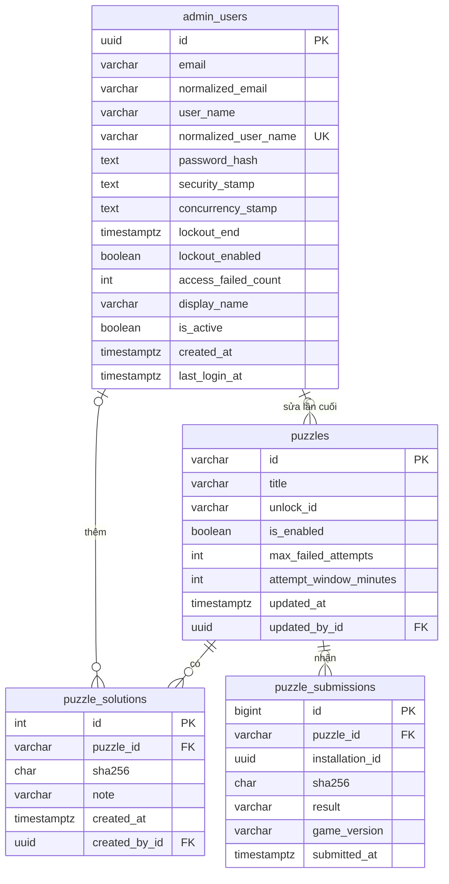
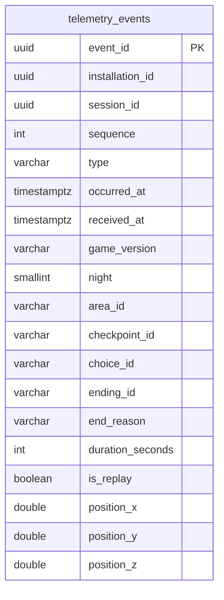

# Thiết kế cơ sở dữ liệu

Tách từ `luoc-do-lop-may-chu.md`: lược đồ quan hệ thực thể và các bảng của PostgreSQL.

## 1. Lược đồ quan hệ thực thể

PostgreSQL 17. Tên bảng và cột viết snake_case bằng gói `EFCore.NamingConventions` (`UseSnakeCaseNamingConvention`), để viết SQL tay khi xem dữ liệu không phải đặt tên trong ngoặc kép. Thời gian dùng `timestamptz` và luôn lưu UTC.

`telemetry_events` không nối với bảng nào: sự kiện chỉ mang mã cài đặt, và máy chủ không có bảng người chơi. Bảng này vẽ riêng ở mục 2.

## 2. Bảng `telemetry_events`

| Cột | Kiểu | Ràng buộc | Ghi chú |
|---|---|---|---|
| `event_id` | `uuid` | khóa chính | Game sinh; dùng để bỏ trùng |
| `installation_id` | `uuid` | not null | |
| `session_id` | `uuid` | not null | |
| `sequence` | `integer` | not null, `>= 0` | |
| `type` | `varchar(32)` | not null | Một trong bảy giá trị của `TelemetryEventType` |
| `occurred_at` | `timestamptz` | not null | Giờ trên máy người chơi |
| `received_at` | `timestamptz` | not null | Giờ máy chủ nhận |
| `game_version` | `varchar(16)` | not null | Lấy từ vỏ lô |
| `night` | `smallint` | null, 1 đến 9 | |
| `area_id` | `varchar(64)` | null | |
| `checkpoint_id` | `varchar(64)` | null | Chỉ `player_caught` |
| `choice_id` | `varchar(8)` | null | Chỉ `choice_made` |
| `ending_id` | `varchar(32)` | null | Chỉ `ending_reached` |
| `end_reason` | `varchar(16)` | null | Chỉ `session_ended`; trường `reason` của hợp đồng |
| `duration_seconds` | `integer` | null, `>= 0` | `session_ended`, `night_completed` |
| `is_replay` | `boolean` | null | `night_started`, `night_completed` |
| `position_x`, `position_y`, `position_z` | `double precision` | null | Chỉ `player_caught`, tùy chọn |

: Các cột của bảng `telemetry_events`

Chỉ mục: `(installation_id)` cho việc xóa khi rút đồng ý; `(received_at, type)` cho dashboard và CSV.

Không có cột địa chỉ IP, User-Agent hay `platform`. Hợp đồng chỉ có một giá trị `platform` là `windows`, nên chưa cần lưu; thêm nền tảng thì thêm cột bằng migration.

## 3. Bảng `puzzles`

| Cột | Kiểu | Ràng buộc | Ghi chú |
|---|---|---|---|
| `id` | `varchar(64)` | khóa chính | `puzzleId` của hợp đồng |
| `title` | `varchar(128)` | not null | Tên hiện trên trang quản trị |
| `unlock_id` | `varchar(64)` | not null | Trả cho game khi đúng |
| `is_enabled` | `boolean` | not null, mặc định `false` | |
| `max_failed_attempts` | `integer` | not null, 1 đến 100, mặc định 5 | |
| `attempt_window_minutes` | `integer` | not null, 1 đến 10080, mặc định 60 | Tối đa 7 ngày |
| `updated_at` | `timestamptz` | not null | |
| `updated_by_id` | `uuid` | null, khóa ngoại tới `admin_users.id`, `ON DELETE SET NULL` | |

: Các cột của bảng `puzzles`

Dữ liệu tạo sẵn trong migration: một dòng `red-thread-sandal`, tên "Đôi dép chỉ đỏ", `unlock_id` là `ending_red_thread_sandal`, đang tắt, chưa có mã băm. Mã băm của tệp bằng chứng thật không nằm trong repo; quản trị viên nhập trên trang quản trị khi dựng câu đố (task #29, #30).

## 4. Bảng `puzzle_solutions`

| Cột | Kiểu | Ràng buộc | Ghi chú |
|---|---|---|---|
| `id` | `integer` | khóa chính, tự tăng | |
| `puzzle_id` | `varchar(64)` | not null, khóa ngoại tới `puzzles.id`, `ON DELETE CASCADE` | |
| `sha256` | `char(64)` | not null, chỉ `[0-9a-f]` | |
| `note` | `varchar(200)` | not null, mặc định rỗng | |
| `created_at` | `timestamptz` | not null | |
| `created_by_id` | `uuid` | null, khóa ngoại tới `admin_users.id`, `ON DELETE SET NULL` | |

: Các cột của bảng `puzzle_solutions`

Duy nhất: `(puzzle_id, sha256)`.

## 5. Bảng `puzzle_submissions`

| Cột | Kiểu | Ràng buộc | Ghi chú |
|---|---|---|---|
| `id` | `bigint` | khóa chính, tự tăng | |
| `puzzle_id` | `varchar(64)` | not null, khóa ngoại tới `puzzles.id`, `ON DELETE RESTRICT` | Không xóa câu đố còn lịch sử |
| `installation_id` | `uuid` | not null | |
| `sha256` | `char(64)` | not null | Mã băm game gửi, đúng hay sai |
| `result` | `varchar(16)` | not null | `accepted`, `rejected`, `blocked` |
| `game_version` | `varchar(16)` | not null | |
| `submitted_at` | `timestamptz` | not null | |

: Các cột của bảng `puzzle_submissions`

Chỉ mục: `(puzzle_id, installation_id, submitted_at)` cho việc đếm lượt sai trong cửa sổ; `(puzzle_id, submitted_at)` cho trang lịch sử.

## 6. Bảng của ASP.NET Core Identity

`AppDbContext` kế thừa `IdentityUserContext<AdminUser, Guid>` [@ms-identity], nên chỉ có bảng người dùng và ba bảng phụ, không có bảng vai trò vì mọi quản trị viên cùng quyền. Tên bảng đổi cho rõ:

| Bảng | Dùng | Ghi chú |
|---|---|---|
| `admin_users` | Có | Các cột chuẩn của Identity cộng `display_name` (`varchar(64)`), `is_active` (mặc định `true`), `created_at`, `last_login_at` |
| `admin_user_claims` | Không | Identity tạo sẵn |
| `admin_user_logins` | Không | Chỉ dùng khi đăng nhập qua dịch vụ ngoài |
| `admin_user_tokens` | Không | |

: Các bảng của ASP.NET Core Identity

Tên đăng nhập (`user_name`) chính là email, nên chỉ mục duy nhất trên `normalized_user_name` của Identity bảo đảm mỗi email một tài khoản; cấu hình thêm `RequireUniqueEmail = true`.

Hình ở mục 1 chỉ vẽ các cột của `admin_users` mà hệ thống dùng; các cột chuẩn còn lại của Identity (`email_confirmed`, `phone_number`, `two_factor_enabled` và các cột tương tự) có trong bảng nhưng không dùng.
