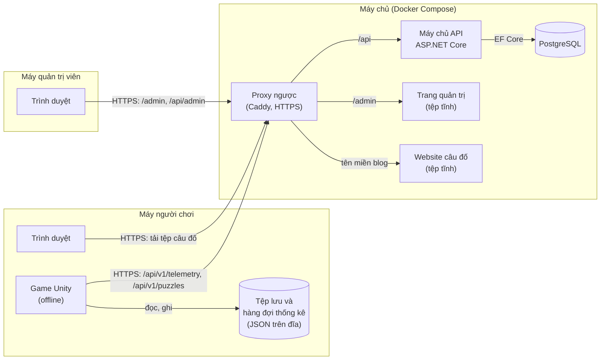
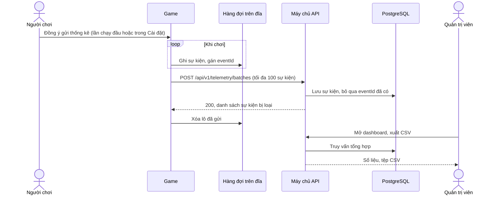
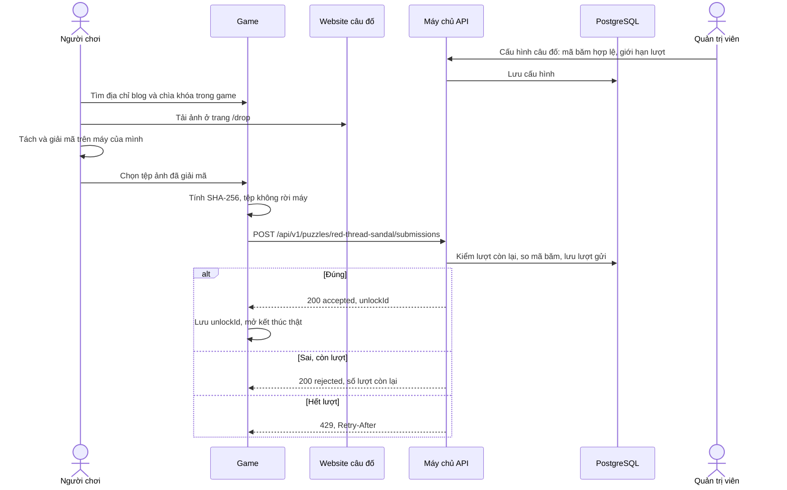
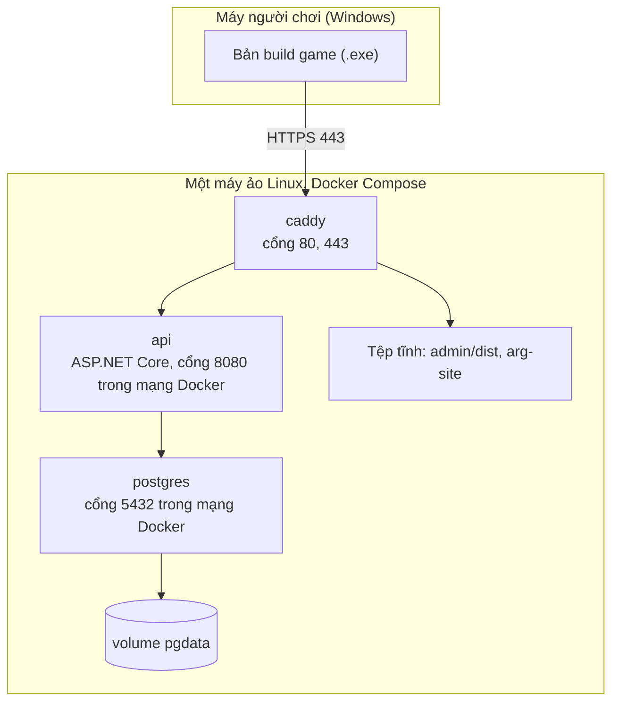

# Kiến trúc hệ thống

Tài liệu cho task #10, một trong ba phần bắt buộc của thuyết minh thiết kế nộp ngày 16/11/2026. Các sơ đồ viết bằng Mermaid, GitHub tự vẽ khi xem tệp; người vẽ bản nộp (draw.io, StarUML) chép lại theo đúng tên thành phần và mũi tên ở đây.

Hợp đồng API giữa game và máy chủ nằm ở `docs/api/openapi.yaml` và `docs/api/README.md` (task #4). Hai tài liệu lệch nhau thì hợp đồng API đúng, sửa tài liệu này.

## 1. Tổng quan

Hệ thống gồm năm thành phần:

| Thành phần | Công nghệ | Chạy ở đâu | Yêu cầu chức năng | Phụ trách |
|---|---|---|---|---|
| Game | Unity 6.3 LTS, C# | Máy tính Windows của người chơi, offline | 1 đến 8 | Phúc, Quang, Tiên, Thắng |
| Máy chủ API | ASP.NET Core trên .NET 10, EF Core | Máy chủ, trong Docker | 9 đến 14 | Quang |
| Cơ sở dữ liệu | PostgreSQL | Máy chủ, trong Docker | 9 đến 14 | Quang |
| Trang quản trị | React, TypeScript, Vite (trang tĩnh) | Trình duyệt của quản trị viên | 9 đến 12 | Thắng, Quang |
| Website câu đố | Trang tĩnh HTML | Trình duyệt của người chơi | 7 | Thắng, Quang |

Ba nguyên tắc chi phối thiết kế:

1. Game chơi được trọn vẹn khi không có mạng. Mạng chỉ cần cho hai việc tùy chọn: gửi thống kê (khi người chơi đồng ý) và gửi bằng chứng câu đố.
2. Người chơi không có tài khoản. Máy chủ chỉ biết một mã cài đặt ngẫu nhiên (`installationId`), không biết người chơi là ai.
3. Game không chứa bí mật. Lời giải câu đố (mã băm của bằng chứng đúng) chỉ nằm trên máy chủ.

## 2. Sơ đồ thành phần

### 2.1. Game

Các khối bên trong (chi tiết lớp ở task #11):

| Khối | Việc |
|---|---|
| Điều khiển nhân vật | Góc nhìn thứ nhất: đi, chạy, cúi, tương tác (yêu cầu 1) |
| Màn chơi và kịch bản | Thứ tự màn, sự kiện theo mốc giờ, biến truyện, lựa chọn, kết thúc (yêu cầu 2, 3) |
| Điện thoại | Giao diện hai chiếc điện thoại: tin nhắn, ảnh, ghi âm, cài đặt (yêu cầu 3) |
| Ẩn nấp | Người quan sát, nón nhìn, thanh chú ý, điểm lưu (yêu cầu 4) |
| Lưu game | Tệp JSON trong `Application.persistentDataPath`: tiến độ, biến, `installationId`, trạng thái đồng ý (yêu cầu 5) |
| Cài đặt | Âm lượng, độ nhạy chuột, đồ họa, cảnh báo nội dung, đồng ý thống kê (yêu cầu 6, 8) |
| Thống kê | Ghi sự kiện vào hàng đợi trên đĩa, gửi theo lô khi có mạng (yêu cầu 6) |
| Gửi bằng chứng | Chọn tệp, tính SHA-256 trên máy, gửi mã băm (yêu cầu 7) |
| Máy khách HTTP | Gọi API, thử lại khi lỗi theo bảng trong hợp đồng API |

Địa chỉ máy chủ ghi trong cấu hình của bản build. Game không có khóa API.

### 2.2. Máy chủ API

Một ứng dụng ASP.NET Core, chia ba lớp:

| Lớp | Việc |
|---|---|
| Controller | Nhận yêu cầu HTTP, kiểm dữ liệu vào, trả lỗi theo RFC 9457 |
| Dịch vụ | Quy tắc nghiệp vụ: bỏ trùng sự kiện theo `eventId`, so mã băm, đếm lượt gửi sai, tổng hợp số liệu dashboard, xuất CSV |
| Truy cập dữ liệu | EF Core, `DbContext`, migration |

Hai nhóm API:

| Nhóm | Đường dẫn | Ai gọi | Xác thực |
|---|---|---|---|
| API công khai | `/api/v1/telemetry/...`, `/api/v1/puzzles/...`, `/health` | Game | Không; chống lạm dụng bằng giới hạn tần suất theo địa chỉ IP (trong bộ nhớ) và giới hạn lượt sai theo mã cài đặt (trong cơ sở dữ liệu) |
| API quản trị | `/api/admin/...`: đăng nhập, tài khoản, dashboard, xuất CSV, cấu hình câu đố, lịch sử gửi | Trang quản trị | ASP.NET Core Identity, cookie phiên |

Đường dẫn chi tiết của API quản trị chốt ở task #12 và thêm vào `openapi.yaml`.

### 2.3. Cơ sở dữ liệu

Các nhóm dữ liệu chính (lược đồ chi tiết ở task #12):

| Dữ liệu | Nguồn ghi | Ghi chú |
|---|---|---|
| Sự kiện thống kê | API công khai | Khóa là `eventId` để bỏ trùng; có `installationId`, loại, thời điểm, đêm, khu vực, dữ liệu riêng của từng loại. Không có IP |
| Câu đố | Trang quản trị | `puzzleId`, bật hay tắt, các mã băm hợp lệ, số lượt sai và cửa sổ thời gian |
| Lượt gửi bằng chứng | API công khai | `installationId`, mã băm đã gửi, kết quả, thời điểm |
| Tài khoản quản trị | Trang quản trị | Các bảng của ASP.NET Core Identity; mật khẩu lưu dạng băm |

Dashboard tính trực tiếp từ bảng sự kiện bằng truy vấn tổng hợp. Lượng dữ liệu của đồ án nhỏ nên chưa cần bảng tổng hợp sẵn.

### 2.4. Trang quản trị

Ứng dụng một trang (single-page application) React, build ra tệp tĩnh, proxy ngược phục vụ ở `/admin`. Trang quản trị và API nằm cùng một tên miền nên cookie đăng nhập dùng thẳng, không cần cấu hình CORS. Kiểu dữ liệu TypeScript sinh từ `openapi.yaml`, không viết tay.

### 2.5. Website câu đố

Blog hư cấu của nhân vật Ngân, gồm trang `/drop` không có liên kết trỏ tới và tệp ảnh chứa dữ liệu đã mã hóa (kịch bản bản 5, mục 8). Toàn bộ là trang tĩnh, không gọi API, không thu dữ liệu người xem. Website đặt ở tên miền riêng, không ghi tên game, để trông như blog thật của nhân vật.

Website câu đố và máy chủ API không nói chuyện với nhau. Mối nối duy nhất là quản trị viên: khi dựng câu đố, tính SHA-256 của tệp bằng chứng gốc rồi nhập vào cấu hình câu đố trên trang quản trị.

## 3. Luồng dữ liệu

### 3.1. Thống kê ẩn danh (yêu cầu 6, 10, 11, 13)

Khi người chơi rút đồng ý: game xóa hàng đợi trên máy và gọi `DELETE /api/v1/telemetry/installations/{installationId}`; máy chủ xóa mọi sự kiện của mã cài đặt đó.

Khi mất mạng: lô nằm lại trong hàng đợi, game thử lại theo thời gian chờ tăng dần. Chơi game không bị ảnh hưởng.

### 3.2. Bằng chứng câu đố (yêu cầu 7, 12, 14)

### 3.3. Quản trị (yêu cầu 9 đến 12)

Quản trị viên đăng nhập trên trang quản trị; API kiểm tài khoản bằng ASP.NET Core Identity và cấp cookie phiên. Mọi yêu cầu tới `/api/admin/...` không có cookie hợp lệ nhận 401.

## 4. Sơ đồ triển khai

| Dịch vụ Compose | Ảnh | Mở ra ngoài | Ghi chú |
|---|---|---|---|
| `caddy` | `caddy` | 80, 443 | Tự lấy chứng chỉ HTTPS; phục vụ tệp tĩnh của trang quản trị và website câu đố; chuyển `/api` sang `api` |
| `api` | Build từ `server/` | Không | Chuỗi kết nối và mật khẩu đọc từ biến môi trường, không ghi trong repo |
| `postgres` | `postgres` | Không | Dữ liệu nằm trong volume `pgdata`, sao lưu bằng `pg_dump` |

Môi trường:

- Máy cá nhân khi phát triển: `docker compose up` chạy `api` và `postgres`; trang quản trị chạy bằng máy chủ phát triển của Vite; game trỏ tới `http://localhost:8080`. Khi máy chủ chưa xong, game dùng máy chủ giả sinh từ `openapi.yaml` (xem `docs/api/README.md`).
- Bản nộp và chơi thử: cùng tệp Compose, chạy trên một máy ảo Linux. Nhà cung cấp chưa chọn, quyết ở task #32.

Bản build game phát cho người chơi dưới dạng tệp nén cho Windows; kênh phát chưa chọn, quyết ở task #32.

## 5. Bảo mật và quyền riêng tư

- Mọi kết nối ra ngoài máy chủ đi qua HTTPS.
- Game không gửi thông tin định danh; máy chủ không lưu địa chỉ IP hay User-Agent. Địa chỉ IP chỉ dùng trong bộ nhớ để giới hạn tần suất.
- Thống kê chỉ gửi khi người chơi đồng ý; rút đồng ý thì dữ liệu trên máy chủ bị xóa.
- Bằng chứng câu đố không rời máy người chơi; chỉ mã băm được gửi.
- Cơ sở dữ liệu và API không mở cổng ra ngoài; chỉ proxy ngược mở 80 và 443.
- Mật khẩu cơ sở dữ liệu và tài khoản quản trị đầu tiên lấy từ biến môi trường hoặc tệp `.env` không đưa vào repo.

Giới hạn đã chấp nhận: game chạy offline nên người sửa tệp lưu vẫn tự mở được kết thúc thật. Thiết kế chỉ bảo đảm lời giải không nằm trong bản build.

## 6. Ánh xạ yêu cầu chức năng

| Yêu cầu | Thành phần |
|---|---|
| 1. Điều khiển nhân vật | Game: điều khiển nhân vật |
| 2. Chơi theo đêm | Game: màn chơi và kịch bản |
| 3. Điện thoại trong game | Game: điện thoại, màn chơi và kịch bản |
| 4. Ẩn nấp, chạy trốn | Game: ẩn nấp |
| 5. Lưu tiến độ | Game: lưu game |
| 6. Đồng ý gửi thống kê | Game: cài đặt, thống kê; API công khai |
| 7. Gửi bằng chứng | Game: gửi bằng chứng; website câu đố; API công khai |
| 8. Cài đặt | Game: cài đặt |
| 9. Đăng nhập, tài khoản quản trị | Trang quản trị; API quản trị; cơ sở dữ liệu |
| 10. Dashboard thống kê | Trang quản trị; API quản trị (dịch vụ tổng hợp) |
| 11. Xuất CSV | Trang quản trị; API quản trị |
| 12. Quản lý câu đố | Trang quản trị; API quản trị; cơ sở dữ liệu |
| 13. Nhận thống kê theo lô | API công khai; cơ sở dữ liệu |
| 14. Kiểm bằng chứng bằng mã băm | API công khai; cơ sở dữ liệu |

## 7. Tác nhân (dùng cho lược đồ use case, task #9)

| Tác nhân | Tương tác với | Yêu cầu |
|---|---|---|
| Người chơi | Game, website câu đố; máy chủ API qua game | 1 đến 8, 13, 14 |
| Quản trị viên | Trang quản trị | 9 đến 12 |

Game là một phần của hệ thống nên không phải tác nhân; khi game gọi API, game làm thay người chơi.

## 8. Quyết định và lý do

| Quyết định | Lý do | Phương án đã bỏ |
|---|---|---|
| Game offline, không tài khoản người chơi | Game kể chuyện một người chơi; không bắt đăng nhập; giảm dữ liệu cá nhân phải giữ | Tài khoản người chơi và lưu game trên máy chủ |
| Một máy chủ API cho cả game và trang quản trị | Nhóm bốn người, một người làm máy chủ chính; chung một cơ sở dữ liệu | Tách hai dịch vụ |
| Trang quản trị và API cùng tên miền sau proxy ngược | Cookie đăng nhập dùng thẳng, không cần CORS | Hai tên miền, xác thực bằng token |
| Website câu đố là trang tĩnh, tên miền riêng | Không cần máy chủ; trông như blog thật của nhân vật; lời giải không lộ qua API | Phục vụ câu đố từ máy chủ API |
| Gửi mã băm thay vì tệp | Tệp không rời máy người chơi; máy chủ không phải lưu ảnh | Tải tệp lên máy chủ |
| Docker Compose trên một máy ảo | Chạy giống nhau trên máy cá nhân và máy chủ; không phụ thuộc nhà cung cấp | Dịch vụ nền tảng của một nhà cung cấp đám mây |
