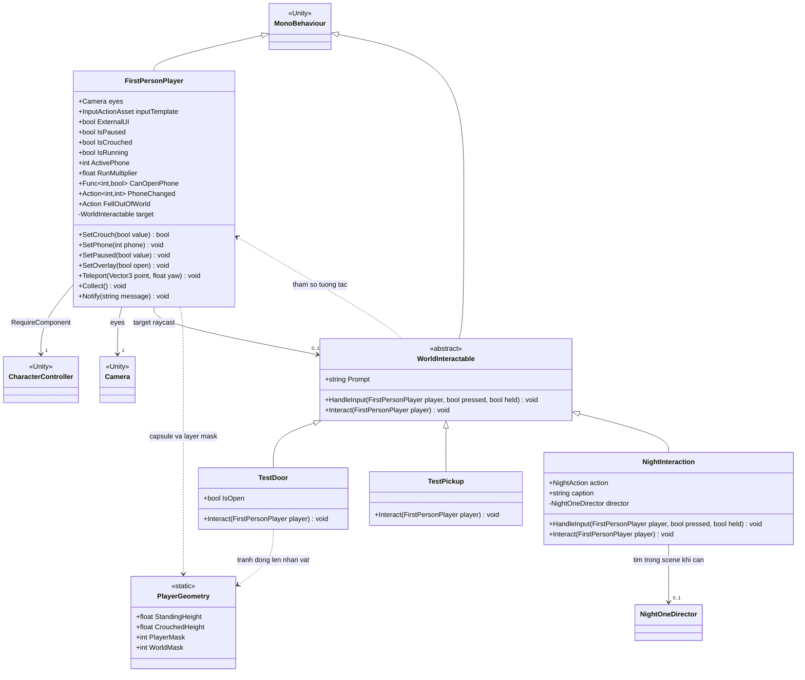
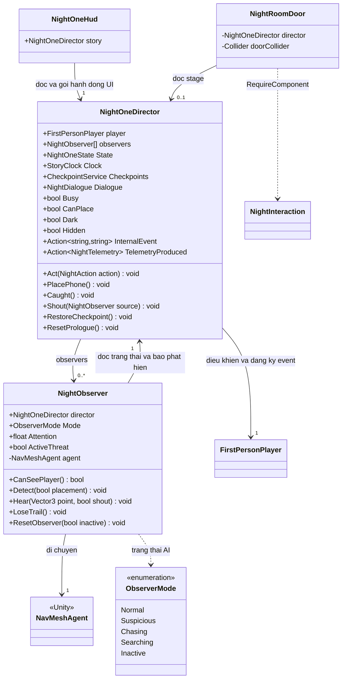
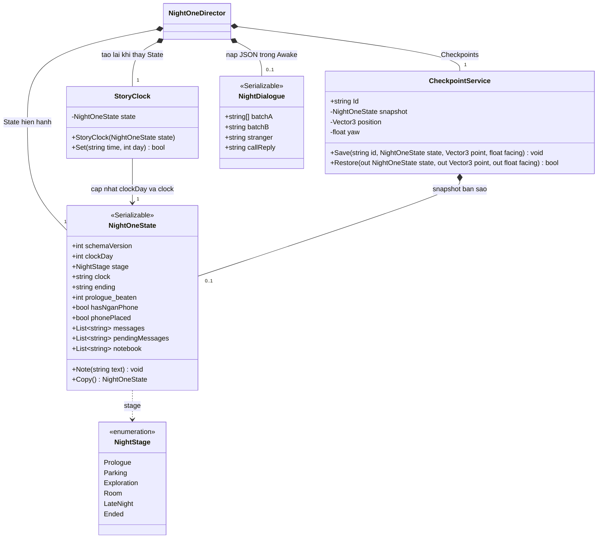
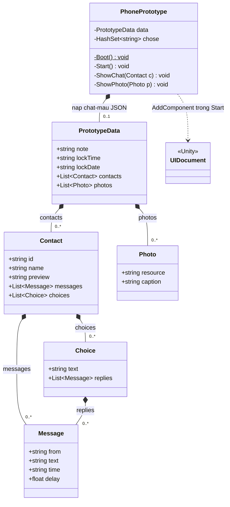
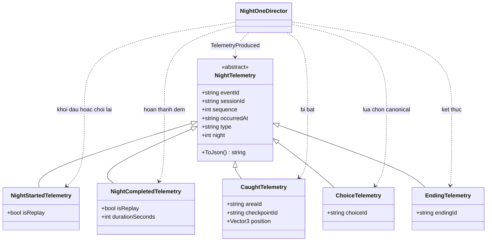

# Lược đồ lớp phần game

Phụ trách: Phúc. Phục vụ #11 và phần lược đồ lớp trong thuyết minh thiết kế #13.

## 1. Phạm vi và phiên bản đối chiếu

Đối chiếu với `main` tại commit [`95b7317`](https://github.com/qivarnq3g/3-gio-12/tree/95b73172d47f7f7cb2bcee8f75c5eb6274cbfbb1), ngày 31/10/2026, sau khi ghép #6, #14 và tài liệu kiến trúc #10. Game hiện dùng **góc nhìn thứ nhất**. Phần máy chủ và web thuộc #12; ranh giới giữa các thành phần xem [kiến trúc hệ thống](kien-truc-he-thong.md).

Các sơ đồ dưới đây mô tả lớp **đã có trong code**. Chỉ liệt kê thành viên liên quan đến trách nhiệm và quan hệ chính, không chép toàn bộ hàm dựng UI, hàm Unity lifecycle hay cấu hình màn chơi. Các kiểu `MonoBehaviour`, `Camera`, `CharacterController`, `NavMeshAgent`, `InputActionAsset`, `UIDocument` là kiểu của Unity/package, không phải lớp tự viết.

| Ký hiệu | Ý nghĩa |
|---|---|
| `A <|-- B` | B kế thừa A |
| `A --> B` | A giữ tham chiếu tới B; không khẳng định sở hữu vòng đời |
| `A ..> B` | A sử dụng B qua lời gọi, tham số, kiểu dữ liệu hoặc sự kiện |
| `A *-- B` | A tạo và giữ B như thành phần nội bộ |
| `+`, `-`, `#` | Public, private, protected |
| `0..1`, `0..*`, `1` | Số lượng ở đầu quan hệ; có thể thay đổi theo thời điểm chạy |

Trường/property trên sơ đồ giữ nguyên tên code. Sự kiện được ghi bằng kiểu `Action`, delegate kiểm tra điều kiện bằng `Func`; phần giải thích chỉ rõ chiều phát và chiều đăng ký. Getter private không làm property trở thành private. Các quan hệ scene dùng association thay vì composition vì Unity quản lý vòng đời GameObject.

## 2. Nhân vật, camera và tương tác

Nguồn: [FirstPersonPlayer.cs](../../game/Assets/Scripts/Player/FirstPersonPlayer.cs), [WorldInteractable.cs](../../game/Assets/Scripts/Player/WorldInteractable.cs), [PlayerGeometry.cs](../../game/Assets/Scripts/Player/PlayerGeometry.cs), [TestDoor.cs](../../game/Assets/Scripts/Player/TestDoor.cs), [TestPickup.cs](../../game/Assets/Scripts/Player/TestPickup.cs), [NightInteraction.cs](../../game/Assets/Scripts/Story/NightInteraction.cs).

`FirstPersonPlayer` đọc Unity Input System, điều khiển `CharacterController`, xoay camera và raycast tìm `WorldInteractable`. Không có lớp camera riêng: `eyes` là camera con, yaw ở transform nhân vật và pitch ở camera. `PlayerGeometry` tập trung kích thước capsule và layer mask; các chiều cao là hằng số, các mask là property tĩnh.

`WorldInteractable.HandleInput` mặc định gọi `Interact` khi vừa nhấn. `NightInteraction` ghi đè để hỗ trợ giữ E đặt điện thoại; các hành động khác chuyển tới `NightOneDirector.Act(action)`. `TestDoor` và `TestPickup` phục vụ scene thử #6, không phải hệ inventory/cửa tổng quát. Tham chiếu `target` được tìm lại mỗi frame và có thể null.

## 3. Điều phối Đêm 1 và kẻ truy đuổi

Nguồn: [NightOneDirector.cs](../../game/Assets/Scripts/Story/NightOneDirector.cs), [NightObserver.cs](../../game/Assets/Scripts/Stealth/NightObserver.cs), [NightOneHud.cs](../../game/Assets/Scripts/Story/NightOneHud.cs), [NightRoomDoor.cs](../../game/Assets/Scripts/Story/NightRoomDoor.cs).

Bốn lớp `NightOneDirector`, `NightObserver`, `NightOneHud`, `NightRoomDoor` đều kế thừa `MonoBehaviour` (lược bỏ các mũi tên Unity ở sơ đồ này cho dễ đọc). `NightOneDirector` giữ trạng thái cốt truyện, điều kiện hành động, checkpoint và các observer được gán từ scene. Director đăng ký `FirstPersonPlayer.PhoneChanged` và `FellOutOfWorld`, đồng thời gán `CanOpenPhone`; nó gỡ đăng ký khi bị hủy.

`NightObserver` tính tầm nhìn bằng khoảng cách, góc nhìn và raycast, tăng/giảm `Attention`, rồi chuyển `ObserverMode`; `NavMeshAgent` đảm nhiệm đường đi. Khi phát hiện hoặc bắt được người chơi, observer gọi director để xử lý tiếng hô và hậu quả. Director cũng gọi ngược observer để báo tiếng động hoặc reset. Đây là quan hệ hai chiều đang có, chưa tách thành hệ AI độc lập cho #20.

`NightOneHud` vẽ UI qua IMGUI, đọc `story.State` và gọi hành động trên director. `NightRoomDoor` thay đổi `Collider.isTrigger` theo stage, không phải lớp con của `WorldInteractable`; component `NightInteraction` cùng GameObject mới xử lý E.

## 4. Trạng thái, đồng hồ và checkpoint

Nguồn: [NightOneState.cs](../../game/Assets/Scripts/Story/NightOneState.cs), [NightOneDirector.RestoreCheckpoint](../../game/Assets/Scripts/Story/NightOneDirector.cs).

`NightOneState` là DTO serializable chứa tiến độ Đêm 1; sơ đồ chỉ chọn một số field đại diện. `Copy()` dùng `JsonUtility` serialize/deserialize để tạo bản sao. `StoryClock` giữ đúng instance state hiện hành và từ chối mốc thời gian đi lùi; director tạo lại clock sau khi thay state.

`CheckpointService` giữ **một snapshot trong RAM**, vị trí và hướng quay. `Save` sao chép state đầu vào; `Restore` trả một bản sao khác, không đưa instance snapshot ra ngoài. `NightOneDirector` áp dụng lại state, pose và trạng thái thế giới. Riêng hồi phục an toàn trong prologue giữ hình phạt bị bắt, không gọi restore snapshot để xóa hình phạt.

Đây chưa phải lưu game bền vững: không ghi file, không đọc lại sau khi thoát ứng dụng, chưa lưu cài đặt hay nhiều slot. `schemaVersion` hiện là field của DTO, chưa có cơ chế migrate save từ đĩa. Các phần đó thuộc #21 và cần cập nhật sơ đồ khi triển khai.

## 5. Điện thoại: bản thô Đêm 1 và prototype UI

### 5.1. Điện thoại trong NightOneGraybox

Trong scene Đêm 1, `FirstPersonPlayer.ActivePhone` có giá trị 0 (cất), 1 (máy Ngân), 2 (máy sinh viên). Director quyết định có được mở qua `CanOpenPhone`; HUD đọc `ActivePhone` và `NightOneState` để vẽ giao diện. Không có lớp `PhoneController` riêng trong phiên bản này.

`NightOneHud` có các hàm private `DrawPhone`, `DrawModal`; các thao tác gửi tin, tắt nguồn, chọn trả lời được chuyển tới các hàm public `NightOneDirector.Send`, `TogglePower`, `ChooseNumber`. Dữ liệu hội thoại thật lấy từ `NightDialogue` và các field/list của `NightOneState`.

### 5.2. Prototype trong SampleScene

Nguồn: [PhonePrototype.cs](../../game/Assets/Prototype/Scripts/PhonePrototype.cs), [PrototypeData.cs](../../game/Assets/Prototype/Scripts/PrototypeData.cs).

`PhonePrototype` kế thừa `MonoBehaviour`; các DTO còn lại là lớp `[Serializable]` thông thường. `Boot()` là static private và chỉ tự khởi tạo trong `SampleScene`. Prototype dùng UI Toolkit/`UIDocument`, đọc `Resources/Prototype/chat-mau.json`, giữ lịch sử tin đã hiện trong RAM. Tin nhắn đã hiện được lưu trong `Dictionary<string, List<Message>> shown`; lựa chọn đã bấm nằm trong `HashSet<string> chose`.

Prototype này **chưa nối** với director hoặc HUD của Đêm 1; vì vậy không vẽ quan hệ giữa `PhonePrototype` và `FirstPersonPlayer`/`NightOneDirector`. Việc thay UI giữ chỗ bằng điện thoại hoàn chỉnh thuộc #17, cần chốt lại các lớp và luồng dữ liệu khi ghép.

## 6. Sự kiện thống kê và ranh giới gửi mạng

Nguồn: [NightTelemetry.cs](../../game/Assets/Scripts/Story/NightTelemetry.cs), [NightOneDirector.cs](../../game/Assets/Scripts/Story/NightOneDirector.cs). Hợp đồng HTTP: [OpenAPI](../api/openapi.yaml), [hướng dẫn API](../api/README.md).

Director phát `TelemetryProduced` với payload có kiểu; `NightTelemetry` cung cấp UUID, session ID, sequence, thời điểm UTC và JSON. `InternalEvent` là kênh debug nội bộ `(string type, string detail)` riêng, không phải sự kiện HTTP theo OpenAPI. Các lớp payload không kế thừa `MonoBehaviour`.

Trong code game đang đối chiếu **chưa có subscriber sản phẩm gửi HTTP**, consent, installation ID, batch, queue lưu đĩa hay retry. Sơ đồ không thêm lớp gửi mạng giả định; phần adapter game thuộc #25. API server đã có nhánh triển khai riêng không đồng nghĩa game đã gửi được thống kê.

Khi làm adapter, cần chuyển đổi payload nội bộ sang DTO hợp đồng: `CaughtTelemetry.position` chỉ phục vụ cục bộ, không có trong event `player_caught` của OpenAPI; không gửi nguyên `ToJson()` của payload này lên endpoint có schema đóng. `installationId`, `gameVersion`, `platform` nằm ở envelope batch, không phải field của `NightTelemetry`. Việc gửi chỉ diễn ra khi người chơi đồng ý theo tài liệu kiến trúc/API.

## 7. Đối chiếu tiêu chí #11 và phần còn lại

| Nhóm lớp yêu cầu | Đã mô tả | Phạm vi chưa triển khai đầy đủ |
|---|---|---|
| Nhân vật | `FirstPersonPlayer`, camera, `PlayerGeometry` | Mở rộng gameplay theo các đêm sau |
| Tương tác | `WorldInteractable`, `TestDoor`, `TestPickup`, `NightInteraction`, `NightRoomDoor` | Inventory/hệ tương tác tổng quát nếu các issue sau yêu cầu |
| Kẻ truy đuổi | `NightObserver`, `ObserverMode`, quan hệ director/NavMesh | Hệ truy đuổi hoàn chỉnh #20 |
| Lưu game | `NightOneState`, `StoryClock`, `CheckpointService` | Lưu đĩa, tiến độ và cài đặt #21 |
| Điện thoại | HUD Đêm 1 và các DTO/prototype UI Toolkit | Ghép điện thoại hoàn chỉnh #17 |
| Gửi thống kê | Payload `NightTelemetry` và sự kiện phát từ director | Consent, buffer, retry, HTTP adapter game #25 |

Các lớp trình bày phụ (`NightBagPresentation`, `NightInjuryFeedback`, `NightPassingBike`, `TestWorldClock`) và script trong `Assets/Editor/` được lược bỏ để tập trung vào sáu nhóm của issue. Lược bỏ khỏi sơ đồ không có nghĩa xóa hoặc đổi trách nhiệm trong code.

### Hướng dẫn đưa vào thuyết minh

- Giữ các sơ đồ theo từng nhóm để đọc được trên trang báo cáo; không ép toàn bộ vào một hình nhỏ.
- Giữ tên lớp, tên thành viên và chiều mũi tên khi vẽ lại; ghi chú rõ checkpoint RAM và payload cục bộ.
- Mermaid trong Markdown là nguồn chính; GitHub render trực tiếp. Có thể xuất SVG để đưa vào báo cáo bằng Mermaid CLI 11, không chỉnh tay bản xuất thay cho nguồn.
- Khi #17, #20, #21 hoặc phần game #25 được merge, đối chiếu lại sơ đồ và ghi phiên bản code mới trước khi nộp #13.

### Kiểm tra trước khi gộp

- [x] Có đủ sáu nhóm trong yêu cầu #11, ghi rõ hiện trạng và phần còn thiếu.
- [x] Tên lớp/thành viên và quan hệ đã đối chiếu code tại commit nêu trên.
- [ ] Một thành viên khác kiểm tra sơ đồ và approve PR (điều kiện hoàn thành #11).
