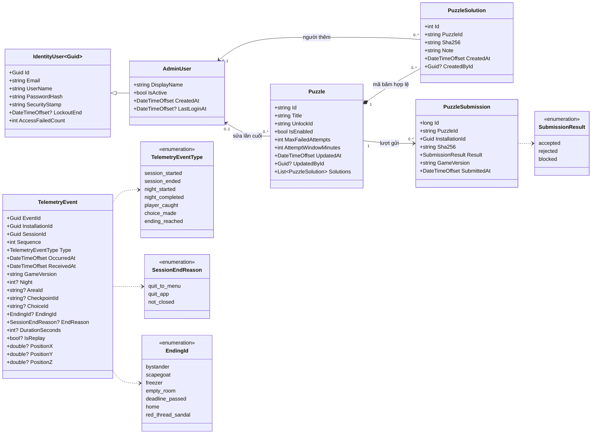
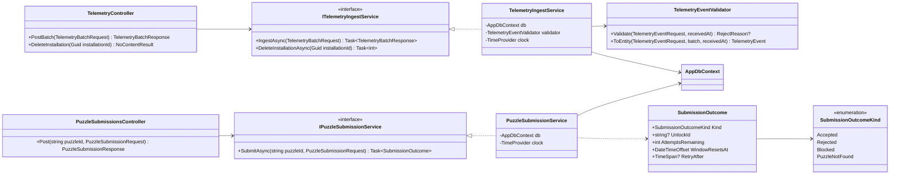
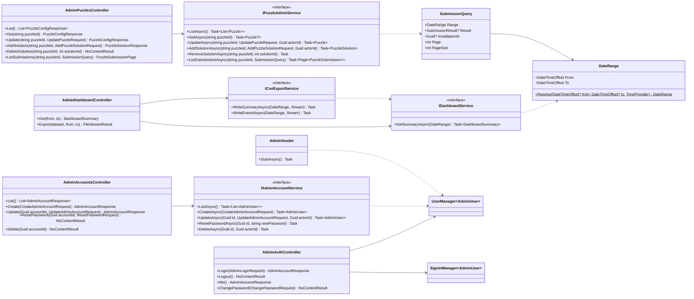
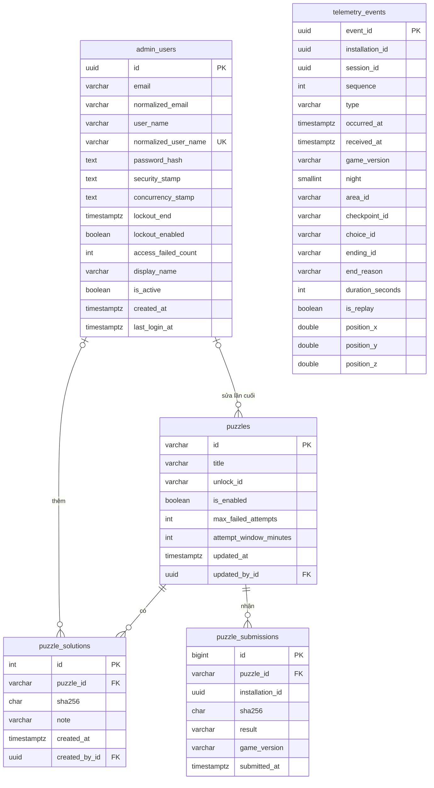
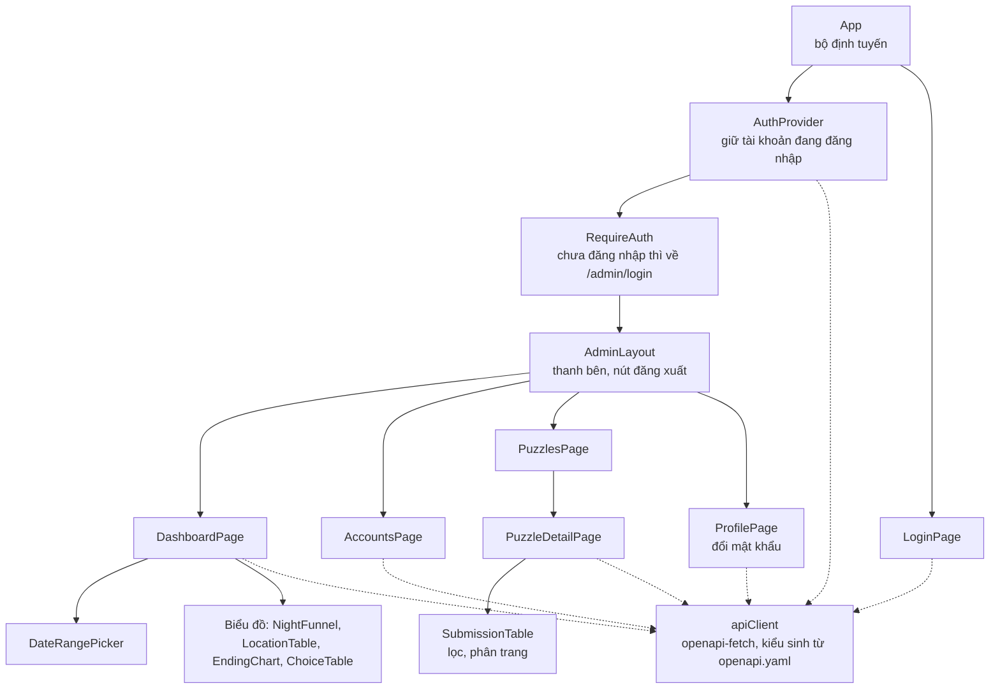

# Lược đồ lớp phần máy chủ và web

Tài liệu cho task #12, một trong ba phần bắt buộc của thuyết minh thiết kế nộp ngày 16/11/2026. Tài liệu đi tiếp từ `kien-truc-he-thong.md` (task #10): ở đó là các thành phần và luồng dữ liệu, ở đây là lớp, dịch vụ và bảng dữ liệu bên trong máy chủ API, cùng cấu trúc trang quản trị.

Hợp đồng API (`docs/api/openapi.yaml`, `docs/api/README.md`) là nguồn đúng. Tên trường, mã lỗi và giới hạn ở đây phải khớp hợp đồng; lệch thì sửa tài liệu này.

Các sơ đồ viết bằng Mermaid. Người vẽ bản nộp chép lại theo đúng tên lớp, thuộc tính và quan hệ ở đây.

## 1. Tổ chức mã nguồn

Máy chủ là một dự án ASP.NET Core (`server/src/ThreeTwelve.Api`), chia theo lớp như mục 2.2 của tài liệu kiến trúc:

| Thư mục | Nội dung | Phụ thuộc vào |
|---|---|---|
| `Controllers/` | Nhận yêu cầu HTTP, kiểm dữ liệu vào, gọi dịch vụ, đổi kết quả thành mã HTTP | `Services/`, `Contracts/` |
| `Contracts/` | Lớp dữ liệu vào ra (DTO, data transfer object) đúng theo schema trong `openapi.yaml` | Không |
| `Services/` | Quy tắc nghiệp vụ | `Domain/`, `Data/`, `Contracts/` |
| `Domain/` | Lớp thực thể và kiểu liệt kê | Không |
| `Data/` | `AppDbContext`, cấu hình bảng, migration | `Domain/` |
| `Auth/` | Cấu hình cookie, tạo tài khoản quản trị đầu tiên | `Domain/`, `Data/` |
| `Health/` | Định dạng phản hồi `/health` (đã có từ task #18) | Không |

Controller không truy cập `AppDbContext` trực tiếp; mọi truy vấn đi qua dịch vụ. Lớp thực thể không bao giờ được trả thẳng ra API; controller luôn đổi sang DTO, để đổi bảng không làm đổi hợp đồng.

Giờ hiện tại lấy từ `TimeProvider` của .NET, không gọi `DateTime.UtcNow`, để test đặt được giờ giả khi kiểm cửa sổ lượt gửi và khoảng thời gian dashboard.

## 2. Lớp thực thể

| Lớp | Ý nghĩa | Ghi chú |
|---|---|---|
| `TelemetryEvent` | Một sự kiện thống kê game gửi lên | Một bảng cho cả bảy loại sự kiện; trường riêng của từng loại để trống khi không dùng (xem mục 6). `ReceivedAt` do máy chủ ghi, `OccurredAt` là giờ trên máy người chơi |
| `Puzzle` | Một câu đố ngoài game | Tạo sẵn bằng migration, khóa là `puzzleId` của hợp đồng (`red-thread-sandal`). Quản trị viên chỉ cấu hình |
| `PuzzleSolution` | Một mã băm SHA-256 được coi là đúng | Một câu đố có thể có nhiều mã băm, ví dụ khi phát hành lại tệp bằng chứng |
| `PuzzleSubmission` | Một lần game gửi bằng chứng | Lưu cả lần đúng, sai và bị chặn để trang quản trị xem lịch sử |
| `AdminUser` | Tài khoản quản trị viên | Kế thừa `IdentityUser<Guid>` của ASP.NET Core Identity; thêm tên hiển thị, trạng thái hoạt động và thời điểm đăng nhập cuối |

Không có lớp người chơi. Máy chủ chỉ biết `InstallationId`, một UUID ngẫu nhiên, nên `TelemetryEvent` và `PuzzleSubmission` chỉ giữ mã này như một giá trị, không trỏ tới bảng nào.

Kiểu liệt kê lưu dạng chuỗi snake_case giống hợp đồng, không lưu số, để đọc thẳng được trong cơ sở dữ liệu và trong tệp CSV.

## 3. Lớp dịch vụ và controller

### 3.1. Phần công khai (game gọi)

| Controller, hành động | API | Dịch vụ | Mã HTTP |
|---|---|---|---|
| `TelemetryController.PostBatch` | `POST /api/v1/telemetry/batches` | `IngestAsync` | 200; 400 vỏ lô sai; 413 quá 256 KiB (giới hạn kích thước thân yêu cầu); 429 giới hạn IP |
| `TelemetryController.DeleteInstallation` | `DELETE /api/v1/telemetry/installations/{installationId}` | `DeleteInstallationAsync` | 204, kể cả khi không có gì để xóa |
| `PuzzleSubmissionsController.Post` | `POST /api/v1/puzzles/{puzzleId}/submissions` | `SubmitAsync` | `Accepted`, `Rejected`: 200; `Blocked`: 429 kèm `Retry-After`; `PuzzleNotFound`: 404 |

Giới hạn tần suất theo địa chỉ IP dùng bộ giới hạn tần suất có sẵn của ASP.NET Core (`AddRateLimiter`), khai báo bằng thuộc tính `[EnableRateLimiting]` trên controller; giữ trong bộ nhớ, không ghi IP vào cơ sở dữ liệu. Ba chính sách: `telemetry`, `puzzle-submit` (20 lần mỗi phút), `admin-login` (10 lần mỗi phút). Hợp đồng chưa chốt con số cho `telemetry`; đề xuất 60 lô mỗi phút cho mỗi IP, chốt khi làm task #25.

### 3.2. Phần quản trị (trang quản trị gọi)

Mỗi giao diện (interface) có một lớp cài đặt cùng tên bỏ chữ `I` (`AdminAccountService`, `DashboardService`, `CsvExportService`, `PuzzleAdminService`), cùng dùng `AppDbContext`; sơ đồ bỏ các lớp đó cho gọn.

| Controller, hành động | API | Dịch vụ |
|---|---|---|
| `AdminAuthController.Login` | `POST /api/admin/auth/login` | `SignInManager.PasswordSignInAsync`, rồi ghi `LastLoginAt` |
| `AdminAuthController.Logout` | `POST /api/admin/auth/logout` | `SignInManager.SignOutAsync` |
| `AdminAuthController.Me` | `GET /api/admin/auth/me` | `UserManager.GetUserAsync` |
| `AdminAuthController.ChangePassword` | `POST /api/admin/auth/password` | `UserManager.ChangePasswordAsync` |
| `AdminAccountsController.List`, `Create` | `GET`, `POST /api/admin/accounts` | `ListAsync`, `CreateAsync` |
| `AdminAccountsController.Update`, `Delete` | `PATCH`, `DELETE /api/admin/accounts/{accountId}` | `UpdateAsync`, `DeleteAsync` |
| `AdminAccountsController.ResetPassword` | `POST /api/admin/accounts/{accountId}/password` | `ResetPasswordAsync` |
| `AdminDashboardController.Get` | `GET /api/admin/dashboard` | `GetSummaryAsync` |
| `AdminDashboardController.Export` | `GET /api/admin/exports/{dataset}` | `WriteSummaryAsync` hoặc `WriteEventsAsync` |
| `AdminPuzzlesController.List`, `Get` | `GET /api/admin/puzzles`, `/{puzzleId}` | `ListAsync`, `GetAsync` |
| `AdminPuzzlesController.Update` | `PATCH /api/admin/puzzles/{puzzleId}` | `UpdateAsync` |
| `AdminPuzzlesController.AddSolution`, `DeleteSolution` | `POST`, `DELETE .../solutions` | `AddSolutionAsync`, `RemoveSolutionAsync` |
| `AdminPuzzlesController.ListSubmissions` | `GET .../submissions` | `ListSubmissionsAsync` |

Cả bốn controller quản trị mang thuộc tính `[Authorize]`. `AdminAuthController.Login` mang `[AllowAnonymous]`.

Dịch vụ báo lỗi nghiệp vụ bằng ba ngoại lệ riêng: `NotFoundException`, `ConflictException`, `ValidationException`. Một bộ xử lý ngoại lệ chung (`IExceptionHandler`) đổi chúng thành 404, 409, 400 dạng RFC 9457. Controller không tự bắt ngoại lệ.

## 4. Quy tắc trong dịch vụ

### 4.1. Nhận lô thống kê

1. `TelemetryEventValidator.Validate` kiểm từng sự kiện: loại có biết không, đủ trường bắt buộc của loại đó không, `occurredAt` có cũ hơn 30 ngày hay sau giờ máy chủ hơn 24 giờ không. Sai thì cho vào `rejected` với lý do `invalid`, `unknown_type`, `too_old` hoặc `in_future`.
2. Các sự kiện hợp lệ được chèn trong một giao dịch bằng `INSERT ... ON CONFLICT (event_id) DO NOTHING`. Số dòng chèn được là `accepted`; phần còn lại là `duplicates`. Cách này đúng cả khi game gửi cùng một lô hai lần song song, điều mà kiểu "đọc trước xem đã có chưa rồi mới chèn" không bảo đảm.
3. `eventId` trùng ngay trong một lô cũng tính là `duplicates`.

`DeleteInstallationAsync` xóa mọi sự kiện có `installation_id` đó bằng một câu `DELETE`. Lượt gửi bằng chứng của mã cài đặt đó không bị xóa: đó không phải thống kê, và cần cho giới hạn lượt.

### 4.2. Kiểm bằng chứng

`PuzzleSubmissionService.SubmitAsync` chạy trong một giao dịch:

1. Đọc câu đố. Không có hoặc `IsEnabled = false` thì trả `PuzzleNotFound`, không ghi gì.
2. Lấy khóa `pg_advisory_xact_lock` theo cặp `(puzzleId, installationId)`, để hai lần gửi cùng lúc của một mã cài đặt không cùng đọc thấy còn lượt.
3. Đếm số lần `rejected` của cặp đó trong `AttemptWindowMinutes` phút gần nhất. Đủ `MaxFailedAttempts` thì ghi một dòng `blocked` và trả `Blocked`, kể cả khi mã băm đúng.
4. So mã băm gửi lên với các `PuzzleSolution` của câu đố. Khớp thì ghi `accepted`, trả `UnlockId`; không khớp thì ghi `rejected`.
5. Tính `AttemptsRemaining`, `WindowResetsAt` và `RetryAfter` theo cửa sổ trượt mô tả trong `docs/api/README.md`.

So mã băm là so chuỗi hex chữ thường đã kiểm định dạng; hợp đồng đã buộc game gửi chữ thường.

### 4.3. Dashboard và CSV

`DateRange.Resolve` đổi `from`, `to` của yêu cầu thành khoảng nửa mở theo UTC: thiếu `to` thì lấy giờ hiện tại, thiếu `from` thì lấy 30 ngày trước `to`; `from` không trước `to` hoặc khoảng dài hơn 366 ngày thì báo lỗi 400.

`DashboardService.GetSummaryAsync` chạy các truy vấn tổng hợp trên `telemetry_events` lọc theo `occurred_at`:

| Số liệu | Cách tính |
|---|---|
| `players` | Đếm `installation_id` khác nhau |
| `sessions` | Đếm `session_started` |
| `playtime` | Tổng và trung bình `duration_seconds` của `session_ended` |
| `nights` | Theo `night`: đếm `installation_id` khác nhau của `night_started` có `is_replay = false`, của `night_completed`; trung bình `duration_seconds` của `night_completed` |
| `caughtLocations` | Nhóm `player_caught` theo `night`, `area_id` |
| `quitLocations` | Nhóm `session_ended` có `night` theo `night`, `area_id` |
| `endings` | Theo `ending_id`: đếm `installation_id` khác nhau của `ending_reached` |
| `choices` | Theo `night`, `choice_id`: đếm `installation_id` khác nhau của `choice_made` |

`CsvExportService.WriteSummaryAsync` gọi `GetSummaryAsync` rồi trải mỗi số thành một dòng `metric,night,key,value`. `WriteEventsAsync` đọc sự kiện theo từng phần và ghi thẳng ra luồng phản hồi, không nạp hết vào bộ nhớ.

### 4.4. Tài khoản quản trị

- Mật khẩu băm bằng `PasswordHasher` mặc định của Identity (PBKDF2). Tối thiểu 12 ký tự, không bắt buộc chữ hoa, số hay ký tự đặc biệt.
- Sai mật khẩu 5 lần liên tiếp thì Identity tạm chặn đăng nhập 15 phút (`LockoutEnd`). Việc này khác với khóa tài khoản (`IsActive = false`), do quản trị viên làm và không tự hết.
- Đăng nhập kiểm thêm `IsActive`; tài khoản đã khóa nhận cùng lỗi 401 như sai mật khẩu.
- Khóa tài khoản, đặt lại hay đổi mật khẩu đều đổi `SecurityStamp`. Cookie kiểm lại dấu này mỗi phút, nên phiên cũ hết hiệu lực trong vòng một phút.
- `UpdateAsync` và `DeleteAsync` nhận `actorId` để từ chối (409) khi người làm tự khóa hoặc tự xóa mình, và khi thao tác làm số tài khoản hoạt động về 0.
- `AdminSeeder` chạy lúc máy chủ khởi động: chưa có tài khoản nào thì tạo một tài khoản từ `Admin__Email` và `Admin__Password`; đã có thì không làm gì.

### 4.5. Cấu hình câu đố

- `UpdateAsync` từ chối (409) việc bật câu đố khi chưa có mã băm hợp lệ nào. Câu đố tạo bằng migration mặc định tắt, nên quản trị viên phải nhập mã băm trước rồi mới bật.
- `RemoveSolutionAsync` từ chối (409) việc bỏ mã băm cuối cùng của câu đố đang bật.
- `AddSolutionAsync` từ chối (409) mã băm đã có trong câu đố.
- Mọi thay đổi ghi `UpdatedAt` và `UpdatedById` vào câu đố.

## 5. Lược đồ cơ sở dữ liệu

PostgreSQL 17. Tên bảng và cột viết snake_case bằng gói `EFCore.NamingConventions` (`UseSnakeCaseNamingConvention`), để viết SQL tay khi xem dữ liệu không phải đặt tên trong ngoặc kép. Thời gian dùng `timestamptz` và luôn lưu UTC.

`telemetry_events` không nối với bảng nào: sự kiện chỉ mang mã cài đặt, và máy chủ không có bảng người chơi.

### 5.1. `telemetry_events`

| Cột | Kiểu | Ràng buộc | Ghi chú |
|---|---|---|---|
| `event_id` | `uuid` | khóa chính | Game sinh; dùng để bỏ trùng |
| `installation_id` | `uuid` | not null | |
| `session_id` | `uuid` | not null | |
| `sequence` | `integer` | not null, `>= 0` | |
| `type` | `varchar(32)` | not null | Một trong bảy giá trị của `TelemetryEventType` |
| `occurred_at` | `timestamptz` | not null | Giờ trên máy người chơi |
| `received_at` | `timestamptz` | not null | Giờ máy chủ nhận |
| `game_version` | `varchar(16)` | not null | Lấy từ vỏ lô |
| `night` | `smallint` | null, 1 đến 9 | |
| `area_id` | `varchar(64)` | null | |
| `checkpoint_id` | `varchar(64)` | null | Chỉ `player_caught` |
| `choice_id` | `varchar(8)` | null | Chỉ `choice_made` |
| `ending_id` | `varchar(32)` | null | Chỉ `ending_reached` |
| `end_reason` | `varchar(16)` | null | Chỉ `session_ended`; trường `reason` của hợp đồng |
| `duration_seconds` | `integer` | null, `>= 0` | `session_ended`, `night_completed` |
| `is_replay` | `boolean` | null | Chỉ `night_started` |
| `position_x`, `position_y`, `position_z` | `double precision` | null | Chỉ `player_caught`, tùy chọn |

Chỉ mục: `(installation_id)` cho việc xóa khi rút đồng ý; `(occurred_at, type)` cho dashboard và CSV.

Không có cột địa chỉ IP, User-Agent hay `platform`. Hợp đồng chỉ có một giá trị `platform` là `windows`, nên chưa cần lưu; thêm nền tảng thì thêm cột bằng migration.

### 5.2. `puzzles`

| Cột | Kiểu | Ràng buộc | Ghi chú |
|---|---|---|---|
| `id` | `varchar(64)` | khóa chính | `puzzleId` của hợp đồng |
| `title` | `varchar(128)` | not null | Tên hiện trên trang quản trị |
| `unlock_id` | `varchar(64)` | not null | Trả cho game khi đúng |
| `is_enabled` | `boolean` | not null, mặc định `false` | |
| `max_failed_attempts` | `integer` | not null, 1 đến 100, mặc định 5 | |
| `attempt_window_minutes` | `integer` | not null, 1 đến 10080, mặc định 60 | Tối đa 7 ngày |
| `updated_at` | `timestamptz` | not null | |
| `updated_by_id` | `uuid` | null, khóa ngoại tới `admin_users.id`, `ON DELETE SET NULL` | |

Dữ liệu tạo sẵn trong migration: một dòng `red-thread-sandal`, tên "Đôi dép chỉ đỏ", `unlock_id` là `ending_red_thread_sandal`, đang tắt, chưa có mã băm. Mã băm của tệp bằng chứng thật không nằm trong repo; quản trị viên nhập trên trang quản trị khi dựng câu đố (task #29, #30).

### 5.3. `puzzle_solutions`

| Cột | Kiểu | Ràng buộc | Ghi chú |
|---|---|---|---|
| `id` | `integer` | khóa chính, tự tăng | |
| `puzzle_id` | `varchar(64)` | not null, khóa ngoại tới `puzzles.id`, `ON DELETE CASCADE` | |
| `sha256` | `char(64)` | not null, chỉ `[0-9a-f]` | |
| `note` | `varchar(200)` | not null, mặc định rỗng | |
| `created_at` | `timestamptz` | not null | |
| `created_by_id` | `uuid` | null, khóa ngoại tới `admin_users.id`, `ON DELETE SET NULL` | |

Duy nhất: `(puzzle_id, sha256)`.

### 5.4. `puzzle_submissions`

| Cột | Kiểu | Ràng buộc | Ghi chú |
|---|---|---|---|
| `id` | `bigint` | khóa chính, tự tăng | |
| `puzzle_id` | `varchar(64)` | not null, khóa ngoại tới `puzzles.id`, `ON DELETE RESTRICT` | Không xóa câu đố còn lịch sử |
| `installation_id` | `uuid` | not null | |
| `sha256` | `char(64)` | not null | Mã băm game gửi, đúng hay sai |
| `result` | `varchar(16)` | not null | `accepted`, `rejected`, `blocked` |
| `game_version` | `varchar(16)` | not null | |
| `submitted_at` | `timestamptz` | not null | |

Chỉ mục: `(puzzle_id, installation_id, submitted_at)` cho việc đếm lượt sai trong cửa sổ; `(puzzle_id, submitted_at)` cho trang lịch sử.

### 5.5. Bảng của ASP.NET Core Identity

`AppDbContext` kế thừa `IdentityUserContext<AdminUser, Guid>`, nên chỉ có bảng người dùng và ba bảng phụ, không có bảng vai trò vì mọi quản trị viên cùng quyền. Tên bảng đổi cho rõ:

| Bảng | Dùng | Ghi chú |
|---|---|---|
| `admin_users` | Có | Các cột chuẩn của Identity cộng `display_name` (`varchar(64)`), `is_active` (mặc định `true`), `created_at`, `last_login_at` |
| `admin_user_claims` | Không | Identity tạo sẵn |
| `admin_user_logins` | Không | Chỉ dùng khi đăng nhập qua dịch vụ ngoài |
| `admin_user_tokens` | Không | |

Tên đăng nhập (`user_name`) chính là email, nên chỉ mục duy nhất trên `normalized_user_name` của Identity bảo đảm mỗi email một tài khoản; cấu hình thêm `RequireUniqueEmail = true`.

Sơ đồ ở trên chỉ vẽ `admin_users`; các cột chuẩn còn lại của Identity (`email_confirmed`, `phone_number`, `two_factor_enabled` và các cột tương tự) có trong bảng nhưng không dùng.

## 6. Ánh xạ với hợp đồng API

| Schema trong `openapi.yaml` | Lớp `Contracts/` | Thực thể hoặc nguồn |
|---|---|---|
| `TelemetryBatch` | `TelemetryBatchRequest` | Vỏ lô; `gameVersion` chép vào từng `TelemetryEvent` |
| `TelemetryEvent` (bảy loại) | `TelemetryEventRequest` | `TelemetryEvent`; `reason` thành `EndReason`, `position` thành ba cột `Position*` |
| `TelemetryBatchResult`, `RejectedEvent` | `TelemetryBatchResponse` | Kết quả của `IngestAsync` |
| `PuzzleSubmission` | `PuzzleSubmissionRequest` | `PuzzleSubmission` |
| `PuzzleSubmissionResult` | `PuzzleSubmissionResponse` | `SubmissionOutcome` |
| `AdminAccount` | `AdminAccountResponse` | `AdminUser` |
| `DashboardSummary` và các schema con | `DashboardSummary` | Truy vấn tổng hợp trên `TelemetryEvent` |
| `PuzzleConfig`, `PuzzleSolution` | `PuzzleConfigResponse`, `PuzzleSolutionResponse` | `Puzzle`, `PuzzleSolution` |
| `PuzzleSubmissionRecord`, `PuzzleSubmissionPage` | `PuzzleSubmissionRecordResponse`, `PuzzleSubmissionPage` | `PuzzleSubmission` |

Gộp bảy loại sự kiện vào một lớp `TelemetryEventRequest` có mọi trường tùy chọn, rồi kiểm theo `type` trong `TelemetryEventValidator`. Làm vậy vì hợp đồng yêu cầu một sự kiện sai chỉ bị loại riêng, không làm hỏng cả lô; nếu để bộ đọc JSON kiểm theo từng kiểu con, một sự kiện sai sẽ làm cả lô nhận 400.

## 7. Trang quản trị

Ứng dụng React, TypeScript, Vite trong thư mục `admin/` (task #27). Không có lớp theo nghĩa hướng đối tượng; sơ đồ dưới là cây thành phần (component) và cách chúng gọi API.

| Trang | Đường dẫn | API dùng | Yêu cầu |
|---|---|---|---|
| `LoginPage` | `/admin/login` | `POST /auth/login` | 9 |
| `DashboardPage` | `/admin` | `GET /dashboard`, `GET /exports/{dataset}` | 10, 11 |
| `AccountsPage` | `/admin/accounts` | `/accounts` và các API con | 9 |
| `ProfilePage` | `/admin/profile` | `POST /auth/password` | 9 |
| `PuzzlesPage` | `/admin/puzzles` | `GET /puzzles` | 12 |
| `PuzzleDetailPage` | `/admin/puzzles/:puzzleId` | `GET`, `PATCH /puzzles/{puzzleId}`, `/solutions`, `/submissions` | 12 |

- Kiểu dữ liệu TypeScript sinh bằng `openapi-typescript` từ `docs/api/openapi.yaml`; `apiClient` dùng `openapi-fetch` với các kiểu đó, nên đổi hợp đồng mà quên sửa trang quản trị thì build báo lỗi.
- `apiClient` gặp 401 thì xóa tài khoản trong `AuthProvider`, và `RequireAuth` đưa về trang đăng nhập.
- Nút xuất CSV là liên kết tới `/api/admin/exports/{dataset}?from=...&to=...`; trình duyệt tự gửi cookie và tải tệp, không cần đọc tệp bằng JavaScript.
- `DateRangePicker` chọn ngày theo giờ Việt Nam và gửi mốc nửa đêm `+07:00`.
- Mã khu vực (`areaId`) hiện kèm tên dễ đọc lấy từ một tệp hằng số trong `admin/`, chép từ danh sách mã của thiết kế màn chơi.

Website câu đố (task #30) là trang tĩnh, không gọi API và không có dữ liệu riêng, nên không có lớp hay bảng trong tài liệu này.

## 8. Quyết định và lý do

| Quyết định | Lý do | Phương án đã bỏ |
|---|---|---|
| Một bảng `telemetry_events` cho bảy loại sự kiện, trường riêng để trống | Truy vấn dashboard chỉ là `GROUP BY` trên một bảng; thêm loại sự kiện chỉ thêm cột tùy chọn | Mỗi loại một bảng (truy vấn phải nối nhiều bảng); một cột `jsonb` (khó kiểm kiểu, truy vấn dài hơn) |
| Bỏ trùng bằng `ON CONFLICT DO NOTHING` | Đúng cả khi gửi song song; một câu lệnh | Đọc trước rồi chèn |
| Câu đố tạo bằng migration, không có API tạo hay xóa | Kịch bản chỉ có một câu đố; yêu cầu 12 chỉ đòi cấu hình | Trang quản trị tạo câu đố mới |
| Nhiều mã băm hợp lệ cho một câu đố | Phát hành lại tệp bằng chứng mà không làm người đã giải bị sai | Một cột mã băm trong `puzzles` |
| Lưu cả lần gửi bị chặn (`blocked`) | Trang quản trị thấy được ai đang dò lời giải | Chỉ lưu lần đúng và sai |
| Khóa tư vấn (advisory lock) theo cặp câu đố và mã cài đặt | Hai lần gửi cùng lúc không vượt được giới hạn lượt; không khóa cả bảng | Mức cô lập `SERIALIZABLE` (phải thử lại khi xung đột) |
| `IdentityUserContext`, không có vai trò | Mọi quản trị viên cùng quyền; bớt bốn bảng không dùng | `IdentityDbContext` đầy đủ với vai trò |
| Lỗi nghiệp vụ là ngoại lệ, đổi sang mã HTTP ở một chỗ | Controller ngắn; mã lỗi nhất quán theo RFC 9457 | Mỗi controller tự kiểm và tự trả lỗi |
| Tên bảng và cột snake_case | Quy ước của PostgreSQL; viết SQL tay không cần ngoặc kép | Tên PascalCase mặc định của EF Core |
